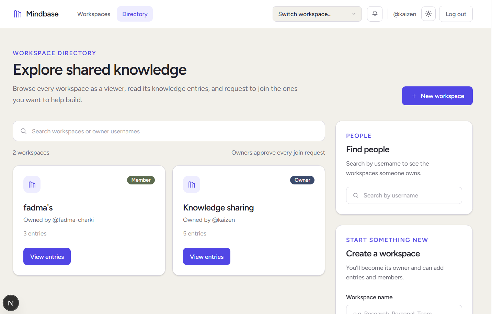
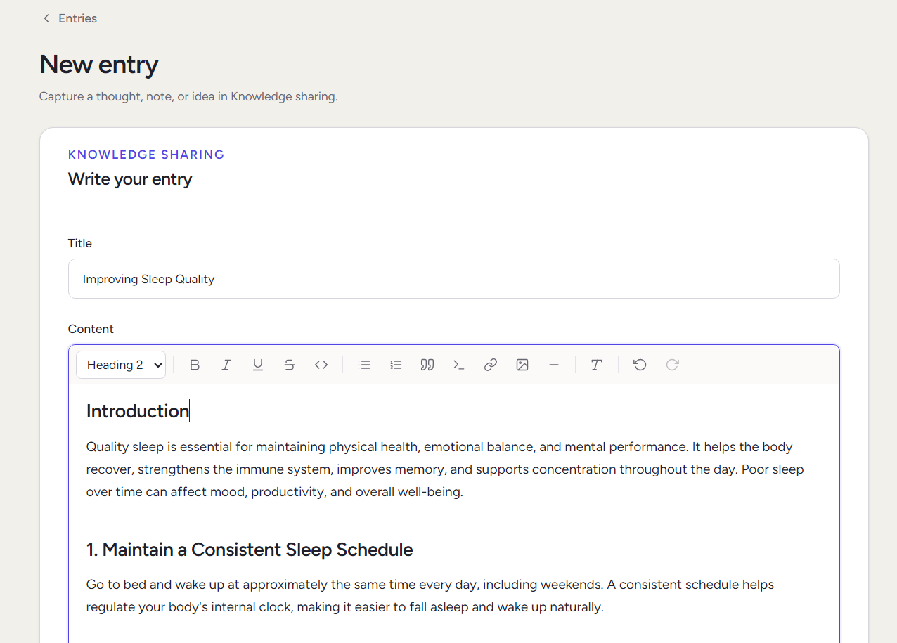
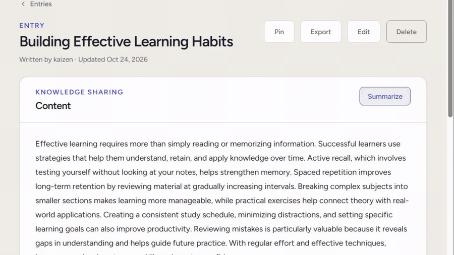
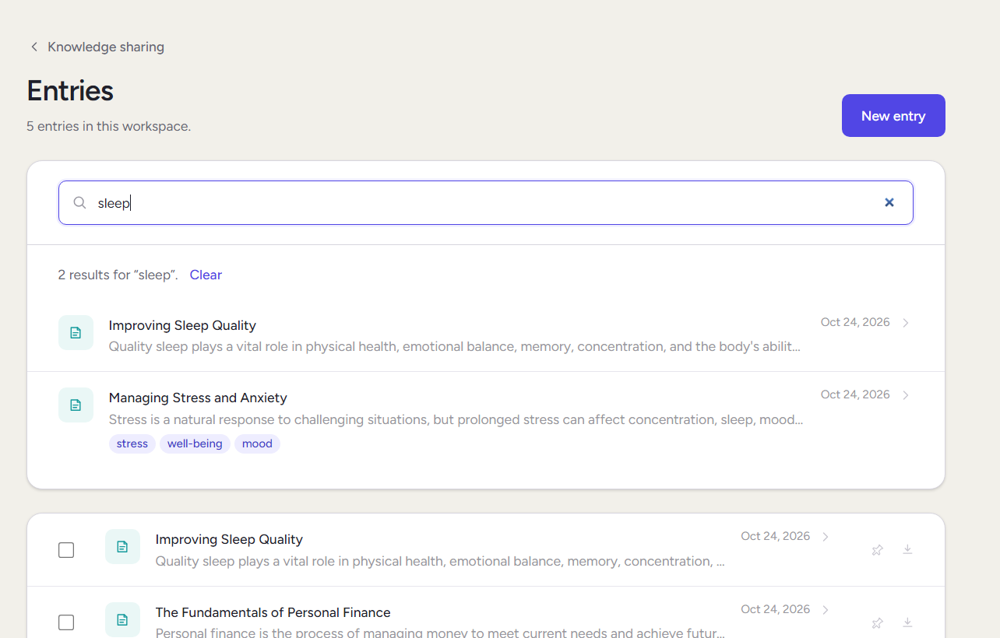
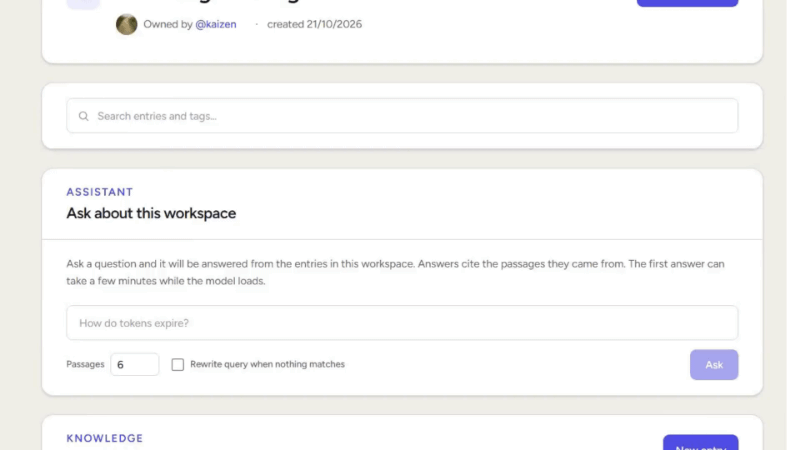
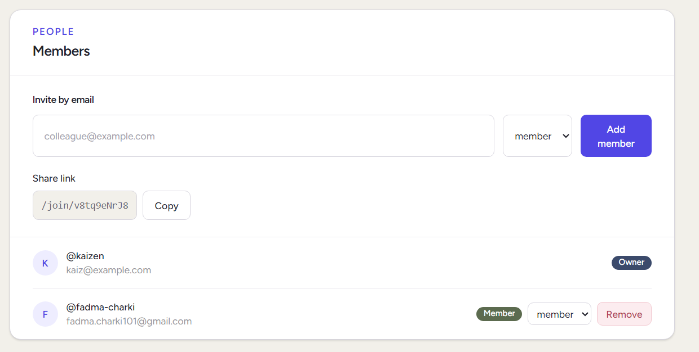
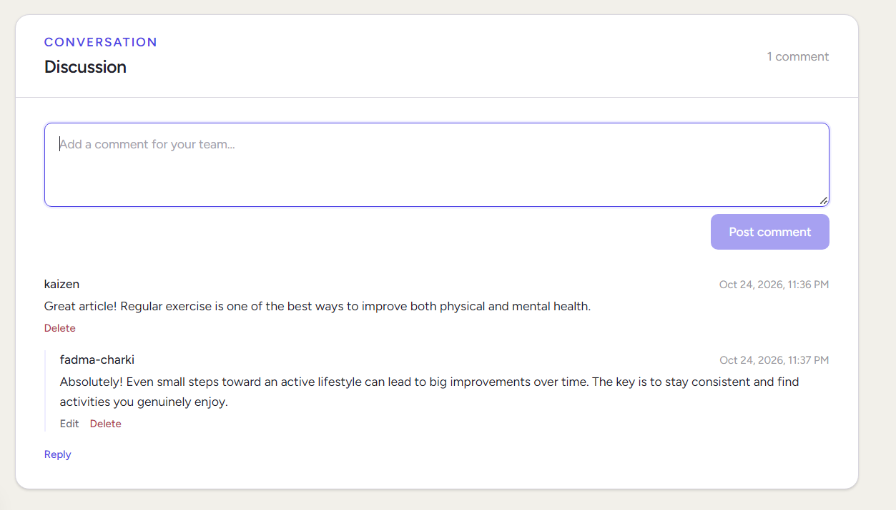
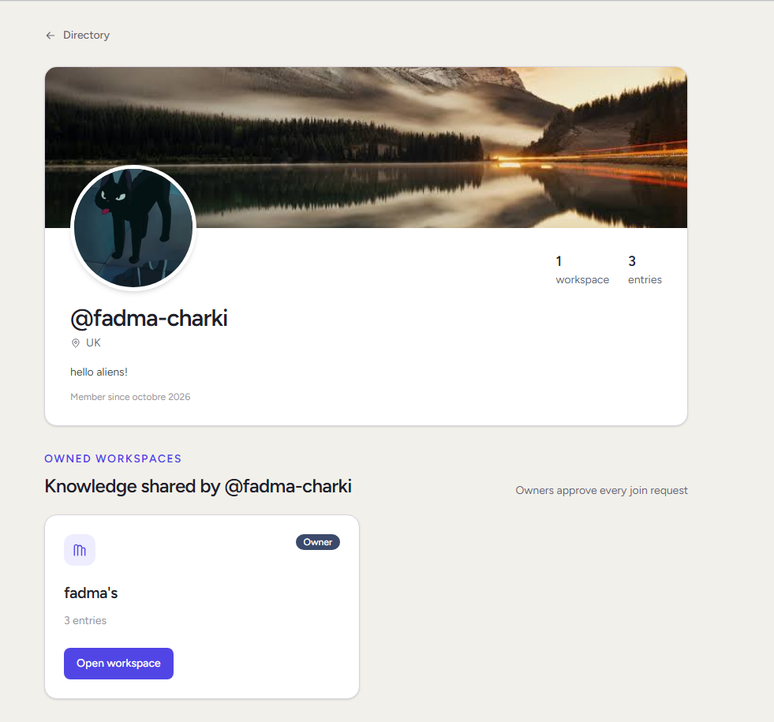
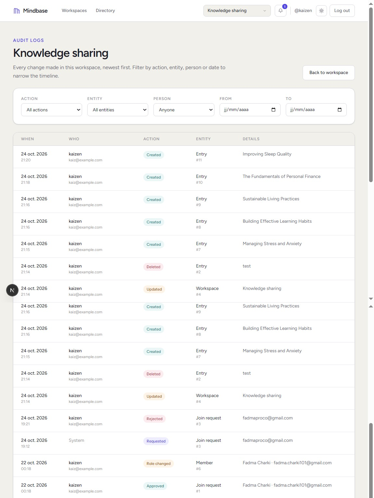

# Mindbase - AI powered Knowledge Manager

A multi-tenant knowledge base where every workspace keeps its own entries, and an
assistant answers questions **from those entries** rather than from a general
model. The whole stack — auth, storage, embeddings, summarization, chat — runs
locally in Docker, so no request leaves the machine.

## Stack

| Layer          | Built with                                                                                        |
| -------------- | ------------------------------------------------------------------------------------------------- |
| Frontend       | Next.js 16 (App Router), React 19, TypeScript, Tailwind 4, TipTap editor                          |
| Backend        | Laravel 12, Sanctum, Socialite, Dompdf, PostgreSQL 18 + pgvector                                  |
| AI service     | Python 3.11, FastAPI, local HuggingFace models (T5-small, bge-m3, Qwen3, optional reranker), PaddleOCR |
| Infrastructure | Docker Compose, nginx + PHP-FPM, supervised queue worker, Redis (optional), Ollama (optional), Mailpit |

## Features

### Accounts and authentication

- Email registration and login, with email verification and password reset.
- Google sign-in through Socialite.
- Sanctum cookie/session auth for the SPA; every workspace route sits behind it.
- Member profiles with a unique username, bio, location and optional photo, plus
  password change and account deletion. Users can search for each other and open
  a public profile that lists the workspaces they own.

### Workspaces and access

- Workspaces with an owner, members, an invite code and role-based access
  (`owner`, `member`, `viewer`).
- A public join page for an invite code, plus request-to-join with owner approval.
- Owners add, re-role and remove members. Every rule is enforced by a policy on
  the model, not only in the controller.

### Knowledge entries

- Rich-text entries (TipTap) with tags and inline images.
- On save, each entry is chunked and embedded (bge-m3, 1024 dimensions) into
  Postgres.
- Stored summaries generated by a local T5 model and regenerable on demand.
- Inline images are uploaded before the entry exists, linked on save, and served
  by an unguessable UUID. Text inside them is read by OCR and indexed with the
  entry, so a fact that only appears in a screenshot is searchable.
- File attachments, with metadata in Postgres and bytes on the documents disk.
  Attached PDFs, Office documents (`.docx`, `.xlsx`, `.pptx`), text files
  (`.txt`, `.md`, `.csv`) and raster images (`.jpg`, `.jpeg`, `.png`, `.gif`,
  `.webp`) are read and their text indexed, so attachments are as searchable as
  the entry itself.
- Pin entries to the top of a workspace list, and apply one action — delete, tag,
  untag or pin — to a whole selection at once.
- Export an entry as Markdown, HTML, JSON or PDF, so a note is not trapped in the
  app.
- Workspace-scoped tags that can nest (a tag may have a parent), with tag names
  suggested from the workspace's own vocabulary.

### Discussions and notifications

- Per-entry comments with one level of replies.
- In-app notifications when someone comments on, or replies to, your entry.

### Search

- Full-text search across entries, tags, attachment text and OCR text.
- Hybrid retrieval over embedded chunks, fusing keyword and vector results by
  rank, so passages from files and screenshots are found alongside entry prose.

### Ask a workspace

- Ask a question and get an answer grounded in the workspace's own passages,
  with citations back to the entries the model read.
- Retrieval runs inline and generation is queued; the client either polls for the
  answer or streams it as server-sent events as the job writes it.
- Regenerate an answer (re-retrieving passages first) and rate an answer with a
  thumbs up or down.

### Interface

- Light and dark themes, following the system preference by default.

### Audit logs and observability

- Owner-only activity history per workspace: entry and workspace changes, plus
  membership and join-request actions.
- Paginated and filterable by action, entity, person and date, in the dashboard
  under **Logs**.
- Structured application logs carry a request id, user id and workspace id, and
  record application actions and AI calls with their latency and outcome.

## Demos

Screenshots and short recordings live in [`doc/assets/`](doc/assets).

### Dashboard

Browse the workspaces you belong to, discover others, and follow the state of
your join requests.



### Entry editor

Write rich-text entries with tags, inline images and file attachments. Entries
are summarized and indexed on save.



### Summarization

Entries carry a stored summary generated by a local T5 model, which can be
regenerated on demand.

<a href="https://res.cloudinary.com/darbw0um8/video/upload/v1794172232/summarization_ued2ob.mp4">
  
</a>

### Hybrid search

Search entry prose, tags, attachment text and OCR text in a single query.



### Ask a workspace

Ask a question and get an answer grounded in the workspace's own passages, with
citations. Answers stream in and can be regenerated or rated.

<a href="https://res.cloudinary.com/darbw0um8/video/upload/v1794172060/ask-workspace_vchnho.mp4">
  
</a>

[Open the full-quality video](https://res.cloudinary.com/darbw0um8/video/upload/v1794172060/ask-workspace_vchnho.mp4)

### Members and join requests

Owners review pending requests, choose a role, and accept or reject them.



### Comments and notifications

Discuss entries in threaded comments and get notified when someone replies.



### Public profile

Public profiles show a cover image, photo, bio and the workspaces a user owns.



### Audit logs

Owners review a filterable history of workspace and membership activity.



## How it works

### Retrieval and summaries

Entries are rich text, chunked and embedded with bge-m3 (1024 dimensions) on
save. Search runs keyword (Postgres full-text) and vector (HNSW) retrieval
together and fuses them by rank rather than by score, since a `ts_rank` and a
cosine distance are not comparable. Anything found is also offered to a
summarizer, so entries carry a short stored summary alongside the full text.

Attachments and inline images are part of that index too: the text extracted
from a PDF, Office document (`.docx`, `.xlsx`, `.pptx`), text file (`.txt`,
`.md`, `.csv`) or image is chunked alongside the entry body, so the paragraph
that answers a question can live in a file or a screenshot rather than in the
note. See [`doc/documents_extraction.md`](doc/documents_extraction.md).

### Images and OCR

Inline images are uploaded to the documents disk before the entry exists and
linked by UUID when the entry is saved. OCR runs as a queued job, so an upload
returns immediately and the image appears in the editor while the text is still
being read.

PaddleOCR runs in the AI service on CPU. It loads lazily on the first OCR call
and returns the recognised lines as newline-separated text. The backend stores
that text on the image, marks the image `ready`, `empty` or `failed`, and
reindexes the entry so the text becomes a retrievable passage. Image attachments
take the same path through `TextExtractionService`. See
[`doc/ocr.md`](doc/ocr.md).

### Asking a workspace

`POST /workspaces/{id}/ask` retrieves passages and returns `202` with a pending
message. A queued job generates the answer from exactly those passages; the
client then either polls `GET /workspaces/{id}/ask/{message}` until the status
flips, or reads the same answer as server-sent events from
`GET /workspaces/{id}/ask/{message}/stream`. Regenerating re-retrieves passages
before queueing a new answer.

Generation is queued because the instruction-tuned model needs minutes on CPU,
which is longer than a request may hold a worker. Retrieval stays inline so a
question with nothing to match is refused immediately instead of after a
multi-minute call. Sources are stored with the answer, so a citation always
refers to the passages the model actually read.

### Logging and observability

Two layers of logs sit behind the API:

- **Audit logs** are each workspace's activity history. Workspace and entry
  changes are captured by Eloquent observers, and membership and join-request
  actions are recorded alongside them, in the `audit_logs` table. The owner
  reviews them in the dashboard under **Logs**, paginated and filterable by
  action, entity, person and date. The endpoint is owner-only, matching the
  policy on the model.
- **Structured application logs** carry a request id, user id and workspace id
  on every line. `RequestId` middleware assigns the id, `RequestContext` reads
  it, and the logging processor copies it onto each entry, so a report can be
  traced across a request and into its queued jobs. Application actions and AI
  calls (`rag`, `summarize`) log their latency and outcome the same way.

## Database

PostgreSQL 18 with pgvector, driven by Eloquent on Laravel 12. 34 migrations,
26 tables — 18 for the app, 8 that Laravel brings along. The app tables fall into
six areas:

| Area           | Tables                                                          |
| -------------- | -------------------------------------------------------------- |
| Accounts       | `users`, `passkeys`, `personal_access_tokens`                   |
| Workspaces     | `workspaces`, `workspace_members`, `membership_requests`        |
| Content        | `knowledge_entries`, `tags`, `knowledge_entry_tag`, `documents`, `entry_images`, `summaries` |
| Retrieval      | `entry_chunks` (pgvector, HNSW + GIN), `assistant_messages`     |
| Discussion     | `comments`, `replies`, `notifications`                          |
| Governance     | `audit_logs`                                                    |

Laravel's own eight are `cache`, `cache_locks`, `failed_jobs`, `job_batches`,
`jobs`, `migrations`, `password_reset_tokens` and `sessions`.

`entry_images` holds each inline upload, its public UUID and URL metadata, and
the text OCR read from it. `documents` holds attachment text the same way.

Two things shape the schema more than anything else. Content is indexed by
**chunks**: on save an entry is split, flattened and embedded into `entry_chunks`
(bge-m3, 1024 dimensions), each row carrying both the vector for similarity
search and the text for keyword search. And every derived row — summary, chunk —
carries a `content_hash` fingerprint of the content it was built from, so a slow
queued job can detect that the entry changed underneath it and refuse to write
stale text.

See [`doc/database-structure.md`](doc/database-structure.md) for the full picture: every
column, the indexes and why they exist, how hybrid search and multi-tenancy work,
the cascade behaviour on deletes, and the schema issues worth fixing.

## Layout

```
backend/       Laravel API, queue worker, migrations, tests
frontend/      Next.js app and typed API clients
ai-service/    FastAPI wrapper around the local models
doc/           design notes: database, extraction, OCR, AI service
docker/        nginx config
docker-compose.yml
```

HuggingFace models are downloaded at runtime into `ai-service/app/models/`, and
PaddleOCR models into `ai-service/app/models/paddlex`. None are in the image.

## Running it

### Prerequisites

- Docker Engine with Compose v2 (Docker Desktop on Windows or macOS).
- About 6 GB of free disk for the images and model weights, and 8 GB of RAM.
- Free host ports: `3001`, `8001`, `8002`, `8025`, `5435` (Postgres) and
  `6379` (Redis). If another Postgres already listens on the chosen port,
  change `POSTGRES_PORT` in the root `.env` and use the same value when
  connecting from the host.

### First start

The root `.env` is read only by Compose; `backend/.env` is read by Laravel.
Copy the templates before the first `up`:

```bash
cp .env.example .env
cp backend/.env.example backend/.env
cp frontend/.env.example frontend/.env
```

Set `POSTGRES_PASSWORD` in `.env` to a value of your choosing. Compose passes the
root database settings into the backend, so `backend/.env` does not need to
match for a Docker-only run; if you run Laravel natively instead, point
`DB_HOST` at `127.0.0.1` and `DB_PORT` at `POSTGRES_PORT`.

```bash
docker compose up -d --build
docker compose exec backend php artisan key:generate
docker compose exec backend php artisan migrate
```

The `knowledge_manager` database itself is created by the Postgres image on
first boot from `POSTGRES_DB`; `migrate` creates the tables. The frontend, API
and AI service then come up at:

| Service         | URL                              |
| --------------- | -------------------------------- |
| Frontend        | http://localhost:3001            |
| API             | http://localhost:8001            |
| AI service      | http://localhost:8002            |
| Mailpit         | http://localhost:8025            |
| Postgres (host) | `localhost:5435`                 |
| Redis (host)    | `localhost:6379`                 |

Optional demo data: `docker compose exec backend php artisan db:seed` creates
four users (password `Password@123`). The knowledge-entry seeder additionally
needs a workspace, so create one in the UI first.

Redis is started by default and used for the cache (`CACHE_STORE=redis` in
Compose); the queue stays on Postgres. Set `CACHE_STORE=database` to keep the
cache in Postgres instead. Ollama is the only profile-gated service and is off
by default; it can answer `/rag` in place of the bundled Qwen checkpoint. Start
it with `docker compose --profile ollama up -d`.

The backend container runs nginx, PHP-FPM and a queue worker under supervisord,
since summaries, OCR and assistant answers are produced by queued jobs.

First start pulls roughly 3 GB of model weights and takes a few minutes.
PaddleOCR downloads its models on the first image OCR rather than at startup.

Stop the stack with `docker compose down`. Add `-v` to also delete the volumes,
which drops the database and uploaded documents.

### Troubleshooting

- **`migrate` cannot connect**: wait for `docker compose ps` to report the
  Postgres container healthy; the backend starts only after its healthcheck.
- **Port already in use**: another Postgres (for example a native install on
  `5434`) is bound to the same port. Change `POSTGRES_PORT` and reconnect.
- **First search or answer returns 504**: the embedding or generation model is
  still loading. The first call after a container start pays the model load;
  see the timeout ordering under [Performance notes](#performance-notes).
- **Queued work never finishes**: check `docker compose logs backend` for the
  supervisord queue worker, and that `QUEUE_CONNECTION` is `database`.

## Tests

```bash
cd backend    && php artisan test
cd ai-service && python -m pytest -q
cd frontend   && npm run typecheck && npm run lint
```

Backend tests run on in-memory SQLite. Vector search only exists on Postgres, so
retrieval falls back to a keyword match there and the tests exercise that path
rather than pretending otherwise; the Postgres-only tests skip unless
`DB_CONNECTION=pgsql`. `backend/phpunit.postgres.xml` opts into a real Postgres
and expects a separate `knowledge_manager_testing` database:

```bash
cd backend && ./vendor/bin/phpunit -c phpunit.postgres.xml
```

The frontend has no test runner: the command above type-checks and lints.

## Performance notes

Measured on a 4-core CPU container, no GPU:

| Operation                        | Cold    | Warm   |
| -------------------------------- | ------- | ------ |
| Embedding (bge-m3), one sentence | ~210s   | ~0.9s  |
| Answer generation, short         | ~290s   | ~7.6s  |

Two things dominate, and both are avoidable:

- **Model load** happens once per process and is paid again on every restart.
- **Torch thread count** is pinned in `ai-service/app/main.py` from the cgroup CPU
  affinity. Left to infer it from the host's core count it over-subscribed the
  container and cost roughly twelve seconds per search.

Timeout ordering must hold, or a slow job is killed or double-claimed:

```
DB_QUEUE_RETRY_AFTER (3000) > job $timeout (2700) > ai.answer_timeout (2400)
                        > ai.background_timeout (600) > ai.timeout (120)

OCR extraction job $timeout (600) > ai.ocr_timeout (300)
```

nginx's `fastcgi_read_timeout` sits at 600s, above the embedding model's first
load, which otherwise killed the first request of a session as a bare 504.

## Configuration

Three env files are involved: the root `.env` (Compose only: database name,
user, password and host port), `backend/.env` (Laravel and AI budgets, see
`backend/.env.example`), and `frontend/.env` (`NEXT_PUBLIC_API_URL`). All three
are gitignored; only the `.example` templates are committed. Do not commit real
secrets.

The AI service reads its own settings in `ai-service`; see
[`doc/AI_SERVICE.md`](doc/AI_SERVICE.md) for the model details and
`docker-compose.yml` for the values passed into the containers.

OCR settings are `OCR_LANG`, `OCR_MAX_IMAGE_BYTES` and `PADDLE_PDX_CACHE_HOME`,
passed through `docker-compose.yml`. See [`doc/ocr.md`](doc/ocr.md).
