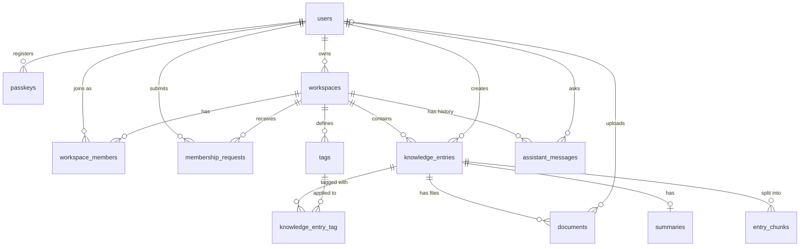

# Database Design

Knowledge Manager stores its data in **PostgreSQL** with the **pgvector**
extension, accessed through Eloquent on Laravel. This document describes how the
schema is organised and why it's shaped the way it is.

**Contents** — [Overview](#overview) · [Tables](#tables) · [Indexes](#indexes) ·
[Search](#how-search-works) · [Revision tracking](#revision-tracking-with-content_hash) ·
[Deletion](#deletion-behaviour) · [Multi-tenancy](#multi-tenancy)

---

## Overview

The app is organised around **workspaces**. A workspace holds knowledge entries
(rich-text notes with attached files and tags), and each entry is chunked and
embedded so it can be searched and used as context for an AI assistant.

| Marker | Area | Tables |
| :---: | --- | --- |
| 🔵 | **Accounts & sign-in** | `users` · `passkeys` · `personal_access_tokens` · `password_reset_tokens` · `sessions` |
| 🟠 | **Workspaces & access** | `workspaces` · `workspace_members` · `membership_requests` |
| 🟢 | **Content** | `knowledge_entries` · `tags` · `knowledge_entry_tag` · `documents` · `summaries` |
| 🟣 | **Retrieval & assistant** | `entry_chunks` · `assistant_messages` |
| ⚪ | **Laravel plumbing** | `jobs` · `job_batches` · `failed_jobs` · `cache` · `cache_locks` |

### Entity relationships



---

## Tables

### 🔵 Accounts

#### 🔵 `users`

| Column | Type | Notes |
| --- | --- | --- |
| `id` | bigserial | PK |
| `name` | varchar | |
| `email` | varchar | unique |
| `google_id` | varchar | unique, nullable (Google sign-in) |
| `email_verified_at` | timestamp | nullable |
| `password` | varchar | hashed |
| `remember_token` | varchar | |
| `two_factor_secret` | text | nullable, encrypted TOTP seed |
| `two_factor_recovery_codes` | text | nullable, JSON |
| `two_factor_confirmed_at` | timestamp | nullable |
| `created_at`, `updated_at` | timestamp | |

`two_factor_confirmed_at` distinguishes a finished 2FA enrolment from an
abandoned one, so login only asks for a code from users who actually completed
setup.

`google_id` is unique and nullable. Postgres allows multiple `NULL`s in a unique
index, so password-only accounts don't collide.

#### 🔵 `passkeys`

WebAuthn credentials: `user_id` (FK, cascade), `name`, `credential_id` (unique,
the lookup key at sign-in), `credential` (json), `last_used_at`. `user_id` is
indexed explicitly, since Postgres doesn't index the referencing side of a
foreign key.

#### 🔵 `personal_access_tokens`

Laravel Sanctum API tokens. Polymorphic owner (`tokenable_type`,
`tokenable_id`), hashed `token` (unique), `abilities`, `last_used_at`,
`expires_at`.

#### 🔵 `password_reset_tokens` and `sessions`

Stock Laravel tables. `password_reset_tokens` is keyed on `email`, so a new
request replaces the previous one. `sessions` is unused: authentication uses
Sanctum bearer tokens.

### 🟠 Workspaces

#### 🟠 `workspaces`

The tenant root.

| Column | Type | Notes |
| --- | --- | --- |
| `id` | bigserial | PK |
| `name` | varchar | |
| `invite_code` | varchar(32) | unique, nullable, generated on create |
| `owner_id` | bigint | FK → `users` |
| `created_at`, `updated_at` | timestamp | |

`unique (owner_id, name)` lets different users each have a workspace called
"Personal" while preventing duplicates within one account. This index also
covers lookups by owner.

#### 🟠 `workspace_members`

Membership with a role (`owner`, `member`, `viewer`), modelled as a pivot with a
custom `Pivot` class so `role` is readable as an attribute.

`workspace_id` and `user_id` (both cascade), `role` (default `member`), and
`unique (workspace_id, user_id)`. A separate `user_id` index serves the
"which workspaces does this user belong to?" lookup that every authorization
check performs.

#### 🟠 `membership_requests`

Requests to join a workspace: `status` (`pending` / `approved` / `rejected`) and
`requested_role` (`member` / `viewer`). Rejections are kept in place rather than
deleted, so there's a record of who asked and what happened.

### 🟢 Content

#### 🟢 `knowledge_entries`

The central record.

| Column | Type | Notes |
| --- | --- | --- |
| `id` | bigserial | PK |
| `workspace_id` | bigint | FK → `workspaces`, cascade |
| `created_by` | bigint | FK → `users` |
| `title` | varchar | |
| `content` | longtext | nullable, **rich-text HTML** |
| `created_at`, `updated_at` | timestamp | |

`content` holds HTML from the editor. Wherever plain text is needed (full-text
search, chunking), the markup is stripped first.

Entries are listed newest-first within a workspace, so the index is
`(workspace_id, created_at)`. It serves both the tenant filter and the ordering.

#### 🟢 `tags`

Workspace-scoped labels: `workspace_id` (cascade), `name`,
`unique (workspace_id, name)`, and a GIN full-text index on `name`. Scoping tags
to a workspace means two workspaces can each have an `urgent` tag.

#### 🟢 `knowledge_entry_tag`

The entries↔tags pivot: `knowledge_entry_id` and `tag_id`, both cascade, with a
composite primary key that makes duplicate tagging impossible. A separate
`tag_id` index supports the reverse lookup ("which entries have this tag?").

#### 🟢 `documents`

Metadata for uploaded files. The file bytes live on a storage disk, not in the
database.

| Column | Type | Notes |
| --- | --- | --- |
| `knowledge_entry_id` | bigint | FK → `knowledge_entries`, cascade |
| `uploaded_by` | bigint | FK → `users`, nullable, **set null** |
| `disk` | varchar | storage disk name, default `documents` |
| `path` | varchar | |
| `original_name` | varchar | |
| `mime_type` | varchar | nullable |
| `size` | bigint | |
| `checksum` | char(64) | nullable, hex SHA-256 |
| `created_at`, `updated_at` | timestamp | |

- `disk` is stored per row so storage can move (for example, local disk to S3)
  without rewriting records.
- `uploaded_by` is **set null** on user deletion: the file and its metadata
  outlive the uploader, only the attribution is lost.
- Files aren't stored in Postgres. Uploads are never queried, and keeping them
  out makes backups and replication cheaper.

Model-level `deleting` hooks remove the file from disk when an entry or document
is deleted, because database cascades don't trigger Eloquent events.

#### 🟢 `summaries`

The AI-generated summary of an entry. One row per entry, rewritten in place.

`knowledge_entry_id` (cascade, **unique**), `content_hash` char(64), `body`
longtext, `backend` varchar(32).

- **Unique per entry:** readers always want the current summary, so there's no
  history table.
- **`content_hash`:** guards against stale summaries overwriting newer ones. See
  [revision tracking](#revision-tracking-with-content_hash).
- **`backend`:** records which model wrote the summary, so cached summaries can
  be identified and regenerated after a model change.

### 🟣 Retrieval

#### 🟣 `entry_chunks`

The retrieval substrate. Each row is one embedded passage, holding both the text
a keyword index can match and the vector a similarity search can rank.

| Column | Type | Notes |
| --- | --- | --- |
| `knowledge_entry_id` | bigint | FK → `knowledge_entries`, cascade |
| `source` | varchar(16) | `summary` or `content` |
| `position` | integer | ordinal within `(entry, source)` |
| `content_hash` | char(64) | revision fingerprint |
| `body` | text | **plain text**, markup already stripped |
| `embedding` | vector(1024) | pgvector |
| `created_at`, `updated_at` | timestamp | |

Indexes:

- unique `(knowledge_entry_id, source, position)`
- `(knowledge_entry_id, source)`
- **HNSW** on `embedding` using `vector_cosine_ops`
- **GIN** on `to_tsvector('english', body)`

Design notes:

- **Vector width follows the embedding model.** The dimension comes from
  `config('ai.embedding_dimension')` (default 1024, matching bge-m3). Changing
  models means rebuilding the column and every vector.
- **The HNSW operator class matches the query operator.** The index uses
  cosine ops and queries use `<=>`, so the planner actually uses it.
- **Positions are per source.** A summary chunk and a content chunk can both be
  at position 0.
- **Chunks are replaced wholesale.** Editing an entry deletes and rewrites all of
  its chunks in one transaction, so a shortened entry never leaves stale passages
  behind.
- **`body` is stored already flattened**, so its GIN index needs no markup
  stripping and search results are readable text.

#### 🟣 `assistant_messages`

One question put to a workspace's assistant, and the answer it produced.

`workspace_id` and `user_id` (both cascade), `question`, `answer` (longtext,
nullable), `sources` (json, nullable), `status` (default `pending`), `error`
varchar(255). Indexed on `(workspace_id, created_at)` because history is read
newest-first.

- **`status`** (`pending` / `ready` / `failed`) lets a polling client tell
  "still working" apart from "gave up". Generation takes minutes, so requests
  return `202` immediately and the row stays `pending` until the job finishes.
- **`sources` is a frozen snapshot** of the passages the model actually saw.
  Re-running retrieval later would cite whatever is indexed now, not what
  produced the answer.
- **Failed rows are kept**, with a readable `error`, rather than deleted.
- **`sources` is JSON, not a join table**: it's immutable and only ever read
  alongside its message. The trade-off is that you can't query "which answers
  cited entry 42?" in SQL.

### ⚪ Laravel plumbing

| Marker | Table | Purpose |
| :---: | --- | --- |
| ⚪ | `jobs` | Database-backed queue |
| ⚪ | `job_batches` | `Bus::batch` counters |
| ⚪ | `failed_jobs` | Dead-letter queue |
| ⚪ | `cache` | Cache store |
| ⚪ | `cache_locks` | Atomic locks |

Using the database as the queue backend lets generation run in the background
without adding Redis.

---

## Indexes

| | Table | Index | Type | Serves |
| :---: | --- | --- | --- | --- |
| 🟠 | `workspaces` | `(owner_id, name)` | unique | Owner-scoped naming |
| 🟠 | `workspaces` | `invite_code` | unique | Invite redemption |
| 🟠 | `workspace_members` | `(workspace_id, user_id)` | unique | No duplicate members |
| 🟠 | `workspace_members` | `user_id` | B-tree | Membership checks |
| 🟠 | `membership_requests` | `(workspace_id, user_id)` | unique | One request per user per workspace |
| 🟠 | `membership_requests` | `user_id` | B-tree | "My requests" |
| 🟢 | `knowledge_entries` | `(workspace_id, created_at)` | B-tree | Entry listing |
| 🟢 | `knowledge_entries` | `created_by` | B-tree | Author's entries |
| 🟢 | `knowledge_entries` | `to_tsvector('english', regexp_replace(title ‖ content))` | **GIN** | Entry search |
| 🟢 | `tags` | `(workspace_id, name)` | unique | Workspace-scoped names |
| 🟢 | `tags` | `to_tsvector('english', name)` | **GIN** | Tag search |
| 🟢 | `knowledge_entry_tag` | `tag_id` | B-tree | Tag → entries |
| 🟢 | `documents` | `(knowledge_entry_id, created_at)` | B-tree | Entry file listing |
| 🟢 | `documents` | `uploaded_by` | B-tree | Foreign-key coverage |
| 🟢 | `summaries` | `knowledge_entry_id` | unique | One summary per entry |
| 🟣 | `entry_chunks` | `(knowledge_entry_id, source, position)` | unique | Chunk identity |
| 🟣 | `entry_chunks` | `(knowledge_entry_id, source)` | B-tree | Source-filtered reads |
| 🟣 | `entry_chunks` | `embedding` | **HNSW** | Similarity search |
| 🟣 | `entry_chunks` | `to_tsvector('english', body)` | **GIN** | Lexical search |
| 🟣 | `assistant_messages` | `(workspace_id, created_at)` | B-tree | Newest-first history |
| 🟣 | `assistant_messages` | `user_id` | B-tree | A user's history |
| 🔵 | `passkeys` | `user_id` | B-tree | Credential listing |
| 🔵 | `personal_access_tokens` | `(tokenable_type, tokenable_id)` | B-tree | Polymorphic lookup |

**Every foreign key column is indexed.** Postgres doesn't index the referencing
side of a foreign key automatically, so each one is covered either by a
composite index that leads with it or by a dedicated index.

> [!NOTE]
> The full-text GIN indexes are **expression indexes**: a query only uses them
> if it spells out the identical expression (same text-search config, same
> `regexp_replace`). The migrations and the search service share that
> expression deliberately.

---

## How search works

Search spans 🟣 `entry_chunks` for passages, 🟢 `knowledge_entries` for
workspace scoping and 🟢 `tags` for filtering. It's **hybrid**: keyword search
and vector search run separately and are then fused.

**Chunks, not whole entries.** One embedding per entry averages every topic
together, so a question about any single topic gets a blurry match. Text is
split into roughly 1800-character chunks with 300 characters of overlap (so a
sentence on a boundary isn't cut in half), capped at 60 chunks per entry.

**Two sources per entry.** The `summary` chunk matches broad questions cheaply.
The `content` chunks carry the specific terms the summary dropped.

**Two queries.**
- *Lexical*: `tsvector @@ tsquery`, ranked by `ts_rank`. Finds exact strings like
  an error code, but doesn't understand meaning.
- *Semantic*: `embedding <=> query`, by cosine distance. Handles paraphrase, but
  has no notion of exact strings.

**Fused with Reciprocal Rank Fusion (k = 60).** RRF combines results by rank
rather than score, because `ts_rank` and cosine distance aren't on comparable
scales.

Guards in the pipeline:

- One vote per chunk per engine, so a repeated chunk can't climb the ranking on
  position alone.
- A **cosine distance cutoff of 0.7**. With bge-m3, paraphrases measured about
  0.25–0.39 and unrelated passages about 0.72–0.75, so 0.7 sits in the gap.
- If the embedding service is down, the semantic side logs a warning and the
  user still gets keyword results.

**Scaling note.** The HNSW index is global, and the workspace filter applies
after the nearest-neighbour search, since pgvector can't partition a vector
index by tenant. A candidate multiplier compensates, and no result ever crosses
a tenant boundary. Under heavy load from other workspaces, a small workspace
might not see its very best passages in the top results.

---

## Revision tracking with `content_hash`

Summaries and chunks are generated by queued jobs that can take minutes, while
edits take seconds. Without protection, a job for revision 1 could finish after
revision 2 and overwrite it with stale data.

Each job therefore carries a SHA-256 fingerprint of the content **at dispatch
time** and re-checks it before writing:

```php
hash('sha256', (string) $content)
```

1. An edit lands; the content hashes to `H1`.
2. Jobs are dispatched carrying `H1`.
3. The user edits again; the content now hashes to `H2`, and new jobs carry `H2`.
4. When the `H1` job finishes, it recomputes the current hash, sees
   `H2 ≠ H1`, and returns without writing.

> [!IMPORTANT]
> The hash must be carried **on the job**, not read when the job runs. Reading it
> at handling time would compare the content to itself and always match.

Chunk positions are assigned *before* embedding, so a chunk the model returns
nothing for leaves a harmless gap instead of colliding with its neighbour.

---

## Deletion behaviour

All deletes are hard deletes; there are no soft deletes. Foreign keys cascade as
follows:

| Delete | Effect |
| --- | --- |
| 🔵 `users` (as workspace owner) | Deletes their 🟠 `workspaces` and everything inside them |
| 🔵 `users` (as entry creator) | Deletes the 🟢 `knowledge_entries` they created, with chunks, summaries, documents and tag links |
| 🔵 `users` (as member) | Removes their 🟠 `workspace_members` rows only |
| 🔵 `users` (as asker) | Deletes their 🟣 `assistant_messages` |
| 🔵 `users` (as uploader) | Nothing is deleted; 🟢 `documents.uploaded_by` is set to null |
| 🟠 `workspaces` | Members, requests, entries, tags and messages, transitively |
| 🟢 `knowledge_entries` | Tags links, documents, summary and chunks |

---

## Multi-tenancy

Tenant isolation is enforced in the application layer, not by the database.

- **Relationships** scope queries from the workspace, for example
  `$workspace->knowledgeEntries()`, `->tags()` and `->assistantMessages()`.
- **Policies** check membership and role. Workspace management is gated on
  `owner_id`; writing entries requires the `owner` or `member` role; document
  access requires membership.

Foreign keys and `workspace_id` columns keep data consistent but don't stop a
query that forgets its tenant filter. The schema doesn't use Postgres
row-level security.

---

## Test environment

The test suite runs on in-memory SQLite for speed. A few migrations branch on the
database driver: full-text indexes are skipped, `entry_chunks.embedding` becomes
a plain `text` column, and search falls back to `LIKE`. The pgvector and
hybrid-ranking paths therefore need a real PostgreSQL instance to exercise.